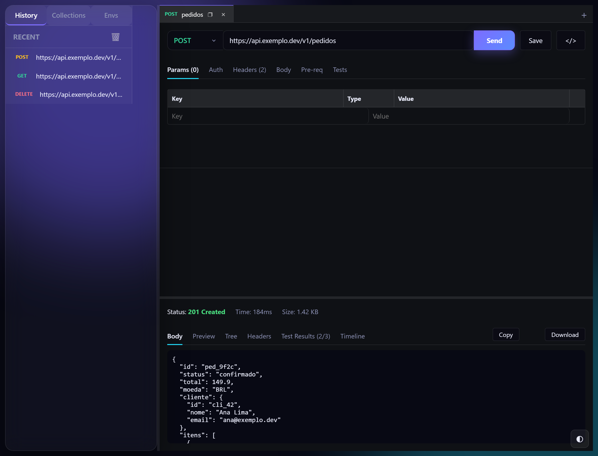
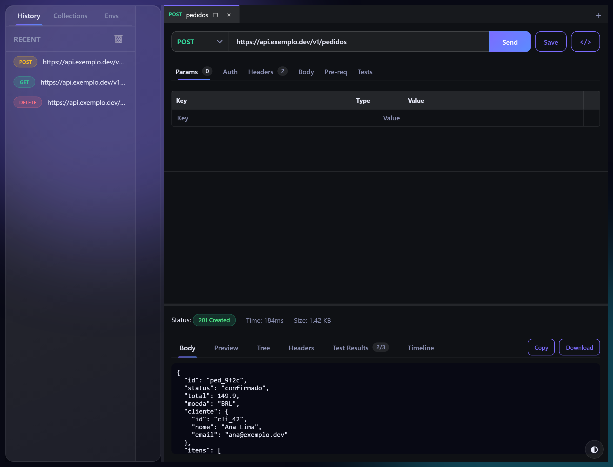

# Sonido 2.5.0 migration

PingHermano now consumes `@juninmd/sonido@^2.5.0` for its UI primitives. The app keeps its
own "Aurora" look (violet accent, glass panels, aurora backdrop) by bridging the Sonido
`--sn-*` tokens to the existing `--*` tokens instead of replacing them.

| Before | After |
| --- | --- |
|  |  |

Both screenshots are the real app at 1180×900 @2x with the same fictitious state
(`POST https://api.exemplo.dev/v1/pedidos`, two collections, two environments and a
201 response with tests). The old build comes from a detached `origin/master` worktree;
the new one from this branch. No harness files are committed.

## Components swapped

| Primitive | Where | Notes |
| --- | --- | --- |
| `Button` | `App.tsx`, `Sidebar.tsx`, `RequestEditor.tsx`, `ResponseViewer.tsx`, `EnvironmentModal.tsx`, `CodeSnippetModal.tsx` | `size="xs"` + `appearance="outline"`/`variant="ghost"` for icon actions; `variant="primary"` keeps the accent gradient. |
| `Badge` | `Sidebar.tsx` method pills, `ResponseViewer.tsx` status + PASS/FAIL | `appearance="soft"`; method colours are still the app's `--get/--post/...`. |
| `Card` | `App.tsx` sidebar panel | `surface="glass"` + `padding="none"`; the wrapper keeps the saved width. |
| `Dialog` | `EnvironmentModal.tsx`, `CodeSnippetModal.tsx` | Replaces both hand-rolled overlays; native `<dialog>` focus trap, Esc and backdrop click. |
| `Select` | `RequestEditor.tsx` method, auth type, add-to, form field type | Local `components/Select.tsx` deleted; native Sonido select keeps tests' `combobox` queries. |
| `Tabs` | `Sidebar.tsx` sections, `RequestEditor.tsx` request tabs, `ResponseViewer.tsx` response tabs, `CodeSnippetModal.tsx` language tabs | Counts moved from the label into the tab `badge`. |
| `TextField` | URL, headers/params/form-data/urlencoded grids, body, pre-request and test scripts, auth fields, environment name/variables, generated code | `multiline` for scripts/body/code; `hideLabel` + `compact` inside grids. |
| `Checkbox` | `EnvironmentModal.tsx` variable enable | Label stays in the accessible name; the text is hidden visually. |
| `EmptyState` | `Sidebar.tsx` (history/collections/environments), `ResponseViewer.tsx` (idle/error) | Radar animation kept as the idle `icon`. |
| `Skeleton` | `ResponseViewer.tsx` loading | Replaces the plain "Loading..." text (`label` keeps the text for tests/screen readers). |
| `Toast`/`ToastProvider` | `App.tsx`, `ResponseViewer.tsx` copy action | "Resposta copiada" notice. |
| `CommandPalette` | `CommandPalette.tsx` | Local overlay/list replaced; command list is mapped to Sonido's `Command`. |
| `Tooltip` + `Kbd` | `App.tsx` theme button, `RequestEditor.tsx` Send hint | `Ctrl`/`Enter` shortcut hint. |

## Domain widgets kept local

These have no generic Sonido equivalent, so they stay as local widgets:

- `JsonTree` and the response `Timeline` visualisation.
- The editable key/value grids (headers, params, form-data, urlencoded). They are inline
  editors, not read-only tables, so `DataTable` is not a fit.
- `ResponseBody` read-only code area and the test-results list (domain of an API client).
- `TabList` (request tabs with close + duplicate) and the resizable split panes
  (`ResizeHandle`).
- `PageHeader` / `ConfirmButton` were not applied: the app has no page-level header, and
  destructive actions intentionally still use the native `confirm()` contract covered by
  tests.

## Identity bridge

`src/renderer/styles/GlobalStyle.tsx` maps `--sn-color-*`, `--sn-gradient`, `--sn-glass*`,
`--sn-radius*`, shadows and fonts to the Aurora tokens. It repeats the selector as
`:root[data-theme='light']` so Sonido's light theme cannot win on specificity. `index.html`
declares `data-theme="dark"` and the existing theme toggle keeps writing `dark`/`light`.
`main.tsx` imports `@juninmd/sonido/styles.css` once, before the app.

## Commands and results

```bash
pnpm install
# + @juninmd/sonido 2.5.0

pnpm typecheck
# tsc --noEmit -> 0 errors

pnpm exec vitest run --pool=threads
# Test Files  58 passed (58)
#      Tests  466 passed (466)

pnpm build
# vite v8.3.5 -> 50 modules transformed, built in 1.05s
# dist/assets/index-*.css  146.28 kB (gzip 26.11 kB)
# dist/assets/index-*.js   372.84 kB (gzip 114.29 kB)
```

There is no `lint` script/dependency in this repository, so there is no lint gate to run.

### Environment notes

- `pnpm test --run` uses the repo's `vmThreads` pool and made no progress on this Windows
  host (killed after >5 min with only the Vitest banner printed). The same suite runs in
  ~35s with `--pool=threads`; CI on Linux is unaffected. This is why the recorded command
  above pins the pool.
- On `origin/master`, `pnpm typecheck` already fails with
  `TS5108: Option 'moduleResolution=node10' has been removed` under the pinned
  TypeScript 7. This PR moves the config to `Bundler` and registers the Vitest/jest-dom
  types so the gate can actually run.
- jsdom 30 exposes `HTMLDialogElement` but not `showModal`/`close`; `test/setup.ts` adds a
  small polyfill so the native `<dialog>` opens in tests. Real Chromium behaviour is
  unchanged.

## Test changes

Only selectors/markup were adapted, plus type-only annotations needed for `tsc`:

- Sidebar section lookup uses `getAllByRole('tab')` (Sonido tabs expose `role="tab"`).
- Dialog close uses `getByLabelText('Fechar')`; backdrop click targets the `dialog` role.
- Row remove buttons are queried as `/Remove/` (they now have an accessible label).
- Card adds a wrapper around the sidebar, so resize tests read `parentElement.parentElement`.
- Textareas inside `TextField` have a label; the old `{ name: '' }` lookups became
  `getByRole('textbox')`.

No tests were skipped. The two tests for the deleted local `Select` were dropped together
with that component; Sonido's native select is exercised by the `RequestEditor` tests
(method, auth and form-data). Suite total goes from 468 to 466 for that reason.
